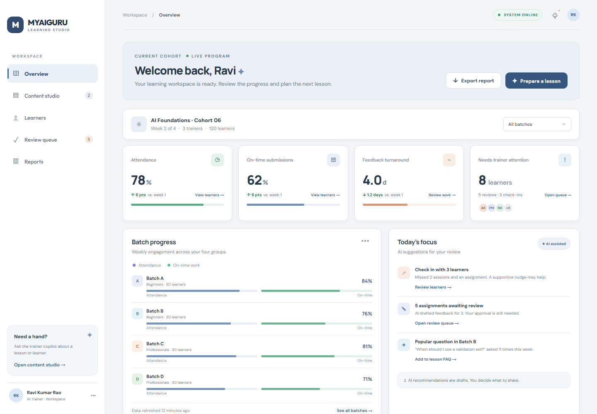

# MYAIGURU Trainer Assistant

A browser-based trainer workspace for **S3K Internship 2026, Case Study 01: AI-Powered Learning Delivery & Trainer Assistant**. The prototype helps a trainer prepare lessons, review learner support suggestions, approve feedback, and inspect cohort progress.

**[Open the live prototype](https://myaiguru-trainer-assistant-ravi.onrender.com/)** · **[Read the assessment PDF](S3K_Ravi_Kumar_Rao_Case_Study_01.pdf)** · **[Download the source ZIP](downloads/s3k-myaiguru-trainer-assistant.zip)**



## What you can explore

| Area | In the prototype |
| --- | --- |
| Overview | Cohort metrics and batch-level views |
| Content studio | Draft a sample lesson, check it, and approve it |
| Learners | Review masked learner check-in suggestions and draft outreach |
| Review queue | Edit rubric-based feedback before approving it |
| Reports | Inspect descriptive insights with their caveats |

The example is based on the case brief's four-batch training scenario. All learner records and metrics in the app are fictional.

## Run locally

You need Python 3.10 or newer. No package installation or API key is required.

```powershell
python server.py
```

Open [http://127.0.0.1:8765/](http://127.0.0.1:8765/). The server creates `myaiguru_demo.sqlite3` on first launch. Stop it with Ctrl+C.

## Suggested walkthrough

1. Select a batch on **Overview** and inspect its progress.
2. Create a lesson draft in **Content studio**, review the checklist, and approve it.
3. Open **Learners** to inspect a masked support suggestion and draft a trainer response.
4. Edit feedback in **Review queue** and approve it; inspect the saved review history.
5. Ask a course question. The answer is drawn from approved sample content; unmatched questions receive an abstention.
6. Open **Reports** to review cohort patterns and their limitations.

## Project files

- [Assessment PDF](S3K_Ravi_Kumar_Rao_Case_Study_01.pdf): submission-ready case study.
- [Assessment source](assessment.md): problem, workflow, UI choices, testing approach, and video outline.
- `server.py`: local HTTP API and SQLite persistence.
- `index.html`, `app.js`, `backend.js`, and CSS files: trainer interface.
- `make_assessment_pdf.py`: builds the PDF from the assessment source.

## Scope and safeguards

This is an interactive **prototype**, not a deployed learning management system. The course Q&A retrieves approved sample material from SQLite; it does not call a generative model. Lesson and feedback approvals are stored with an audit record, but the app has no production login or role enforcement. It does not send learner messages. A production rollout would need identity and access controls, privacy and retention policies, verified content sources, and operational review.

The [narrated case-study video](https://drive.google.com/file/d/1ov5C_jgUtOg05RPnUPmDaRI1MJnN5Jvb/view) is shared separately with S3K HR; Drive access may be required.
