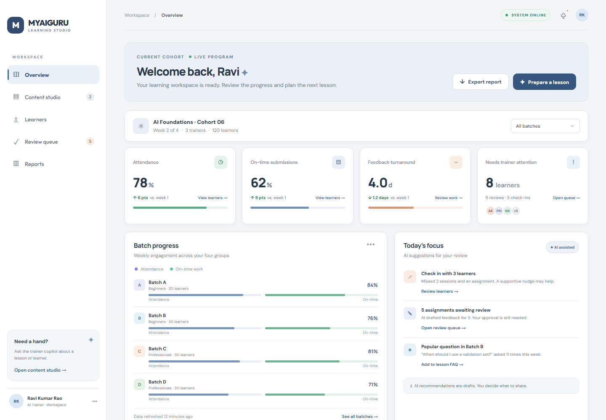

# MYAIGURU — AI-Powered Learning Delivery & Trainer Assistant

**Prepared by:** Ravi Kumar Rao  
**Application email:** ravikumarrao457@gmail.com  
**Candidate case study 01 · Fictional four-week introductory AI program**  
**Live prototype:** https://myaiguru-trainer-assistant-ravi.onrender.com/  
**Local run:** `python server.py` then open `http://127.0.0.1:8765/`. The dashboard uses fictional data in SQLite. Approvals and audit records persist between reloads on the local version. The course Q&A retrieves approved sample answers from SQLite; no generative model or messaging service is connected. Render's free host can reset its demo database when it sleeps or restarts.

## 1. Problem and opportunity

MYAIGURU serves 120 learners across four batches with three trainers. Trainers prepare content, track attendance, review work, answer repeated questions and create progress reports manually. The starting indicators are 78% attendance, 62% on-time assignment submission and four days average feedback turnaround.

The product opportunity is to reduce repetitive preparation and response work while making learner support more timely. AI can draft, summarize and surface patterns. Trainers remain accountable for curriculum, grading, learner outreach and every item shared with learners.

### Stakeholders and current journey

| Stakeholder | Current journey / need |
|---|---|
| Learner | Joins a live session, finds materials across channels, asks questions, submits an assignment and waits for feedback. Needs accessible explanations, timely help and clear expectations. |
| Trainer | Interprets the curriculum, prepares slides and exercises, takes attendance, answers repeated questions, reviews work and compiles reports. Needs less repetitive work and control over teaching quality. |
| Program administrator | Coordinates four batches and trainer coverage, tracks attendance/submissions and reports cohort health. Needs consistent, timely data and an audit trail. |
| Curriculum owner | Defines learning outcomes and approved materials. Needs generated content to remain aligned with the curriculum and current facts. |

### Key pain points

1. Repeated learner questions consume trainer time and answers may vary by batch.
2. Assignment feedback takes four days on average, reducing its value while learners are still practicing.
3. Manual content preparation and reporting make it hard to tailor examples by skill level or spot learners who may need support early.
4. A dashboard signal alone cannot explain why a learner missed class or work; treating it as a diagnosis could harm trust.

### Success measures

| KPI | Baseline | Initial target after 2 cohorts | Why it matters / calculation |
|---|---:|---:|---|
| Attendance rate | 78% | 85% | Learner engagement; attended learner-sessions ÷ scheduled learner-sessions. Compare by batch and week. |
| On-time assignment rate | 62% | 75% | Practice completion; assignments submitted by due date ÷ assignments due. Segment by assignment and batch. |
| Median feedback turnaround | 4 days average | ≤2 days median | Feedback usefulness and trainer workload; time from submission to trainer-approved feedback. Track median and 90th percentile to avoid hiding delays. |

Targets are hypotheses to validate with administrators and trainers. Compare equivalent cohorts and do not attribute improvement to AI alone without a suitable evaluation design.

## 2. Discovery questions

1. **Trainer:** Which parts of preparation, repeated questions and grading take the most time, and what must always remain your personal judgement?
2. **Trainer:** What rubric and feedback tone do you use? Which assignment types can safely receive a suggested draft, and which need a fully manual review?
3. **Administrator:** Where do attendance, submissions and learner rosters live today? Which system is the source of truth, and how often is it updated?
4. **Administrator:** What counts as a missed session, late submission or learner needing outreach? Who can see individual-level records, and what retention rules apply?
5. **Learner:** Where do you get stuck between sessions, and what makes it comfortable or uncomfortable to ask for help?
6. **Learner:** Which languages, device types, connectivity conditions and accessibility features do you need to participate fully?
7. **All groups / curriculum owner:** How do you approve course material, handle corrections and communicate a change to all four batches?

## 3. Redesigned workflow

1. **Prepare:** Trainer selects a curriculum objective, audience and approved source documents. Assistant drafts a lesson outline, examples and quiz items with source references. Trainer checks factual accuracy, answer keys, level, language and accessibility before publishing.
2. **Teach:** Trainer delivers the session. Attendance is imported from the system of record or entered by an authorized trainer. Missing data is labelled “unknown,” never silently treated as absence.
3. **Support between sessions:** Learner asks a question. Assistant searches approved course content and returns an answer with source/module references. If evidence is missing or confidence is low, it says it cannot answer and routes the question to the trainer. Private learner records are not exposed in the general Q&A.
4. **Practice:** Assistant may draft a quiz or hints tied to an objective. Trainer approves the questions and answer key. Learners receive accessible activities with a non-AI route to ask their trainer.
5. **Review:** Assistant drafts rubric-linked feedback without assigning a grade. Trainer checks correctness, tone and learner context, edits if needed, and explicitly approves before anything is shared.
6. **Follow up:** Dashboard surfaces attendance and submission patterns with missing-data indicators. Trainer reviews the context and writes any supportive outreach; AI never diagnoses motivation, disability or risk and never sends a message autonomously.
7. **Report:** Assistant drafts descriptive cohort summaries. Trainer verifies counts and interpretation. Reports show aggregated patterns by default; learner-level details are permission-controlled.

### Human checkpoints and safeguards

- No generated lesson, quiz, answer or feedback is shared before a named trainer approves it.
- Retrieval is limited to versioned, curriculum-approved sources. Every answer shows provenance; no source match means abstain/escalate.
- Trainers verify facts, answer keys, reading level, translations and examples. A change to approved source content is versioned and reviewed.
- No automated grades, pass/fail decisions, discipline, learner ranking or inferred personal traits.
- Use role-based access, least privilege, encrypted transport/storage, audit logs and retention limits. Collect only data required for teaching; use pseudonymous learner IDs in prompts and avoid personal details.
- Learners can ask for a human, report a harmful or incorrect answer, and access core content without using the assistant. Provide low-bandwidth, mobile-friendly and accessible alternatives.
- Before piloting with minors, obtain appropriate institutional/guardian consent, complete privacy review and define safeguarding escalation. The prototype uses fictional data only.

## 4. UI mockup and prompt choices

Run `python server.py` and open `http://127.0.0.1:8765/` for the interactive Trainer Workspace prototype. It includes cohort KPIs, batch filtering, AI suggestions, a lesson drafting workflow with required review checklist, learner pulse, feedback review, a course-grounded question demo and cohort insights. Responsive styling supports laptop and mobile layouts.

**Example lesson prompt:** “Using only the trainer-approved Module 2 source, draft a 60-minute beginner lesson for the objective [objective]. Include a warm-up, explanation, guided activity, three formative checks and an exit ticket. Label every generated item, cite the source section, use English with simple Hindi examples, and flag claims not supported by the source. Do not invent policy or assess a real learner.”

**Example feedback prompt:** “Compare this pseudonymized submission with the trainer-approved rubric. Draft two strengths and one next step in a supportive tone. Do not assign a grade, infer intent or add facts not in the rubric. Return evidence from the learner’s work and cite the rubric criterion. A trainer will review before release.”

Design decisions: leading with cohort-level signals makes workload visible; missing data is separate from low performance; learner names are masked in the demo; AI suggestions carry explicit draft labels; approval checklists prevent accidental release; source tags make provenance visible; the copilot abstains when no approved-content match exists.

**Prototype limitation:** Lesson outlines are templates, and Q&A uses a small approved-answer library in SQLite. The local server stores fictional demo data only and does not call an external AI model or send messages. A production system would need authentication, authorization, source ingestion/versioning, a stronger retrieval service, data retention controls and monitoring before any real learner data is used.

## 5. UAT scenarios

| Scenario | Steps | Expected outcome |
|---|---|---|
| Incorrect AI answer | Ask a question whose answer conflicts with the approved source, or whose source is absent. | Assistant abstains or flags uncertainty, shows available source evidence, adds the question to trainer review and does not publish an answer. Trainer can correct the source-grounded response. |
| Inappropriate or inaccurate lesson material | Generate a lesson containing a questionable example or wrong quiz key; leave one checklist item unchecked and try to approve. | Approval remains disabled until all checks are completed. Trainer can edit/remove the material; the learner receives nothing until approval. The change is logged. |
| Learner privacy / access | A trainer attempts to open another batch’s learner-level assignment feedback; a prompt includes identifiable personal details. | Access is denied and logged for the unauthorized record. Prompt input warns against personal data and production service redacts/rejects it. Aggregated cohort metrics remain available to authorized roles. |

## 6. Seven-minute video outline

| Time | What to cover |
|---|---|
| 0:00–0:40 | Introduce the fictional program and the 78%, 62%, four-day baseline. |
| 0:40–1:30 | Walk through the learner/trainer journey and pain points. |
| 1:30–2:15 | Explain discovery questions and the three KPIs. |
| 2:15–3:15 | Demonstrate dashboard, batch filter and trainer focus suggestions. |
| 3:15–4:20 | Demonstrate lesson draft, source references and trainer checklist. |
| 4:20–5:10 | Show learner Q&A and feedback review; call out abstention and human approval. |
| 5:10–6:00 | Explain privacy, incorrect content safeguards and UAT scenarios. |
| 6:00–7:00 | Teach the beginner concept below; close with prototype limits and next steps. |

### 60-second beginner teaching demo: overfitting

“Imagine you study for a quiz by memorizing the exact practice questions and their answers. You may get those same questions right, but if the teacher changes the wording, you struggle. A machine-learning model can do the same thing: it can memorize patterns in its training examples instead of learning a useful general rule. That is called overfitting. We can check whether a model generalizes by testing it on examples it did not train on. A validation set helps us compare choices while we build the model; a separate test set is saved for a final, fair check. So the key idea is: good training performance is not enough—we also want the model to work on new examples.”

## 7. Tools and contribution

- **Tools used:** Codex for implementation support; HTML, CSS and JavaScript for the browser client; Python standard library and SQLite for the local API and persistent demo records. No external generative AI API is connected.
- **Candidate contribution statement:** “I chose to present the learning-delivery case because it connects to my AI/ML and RAG project experience. I used Codex for idea development, writing support and implementation of the prototype. I recorded the video explanation in my own voice. I take responsibility for checking the workflow, KPIs, safeguards, UAT scenarios and UI and for explaining the choices and limitations accurately.”

